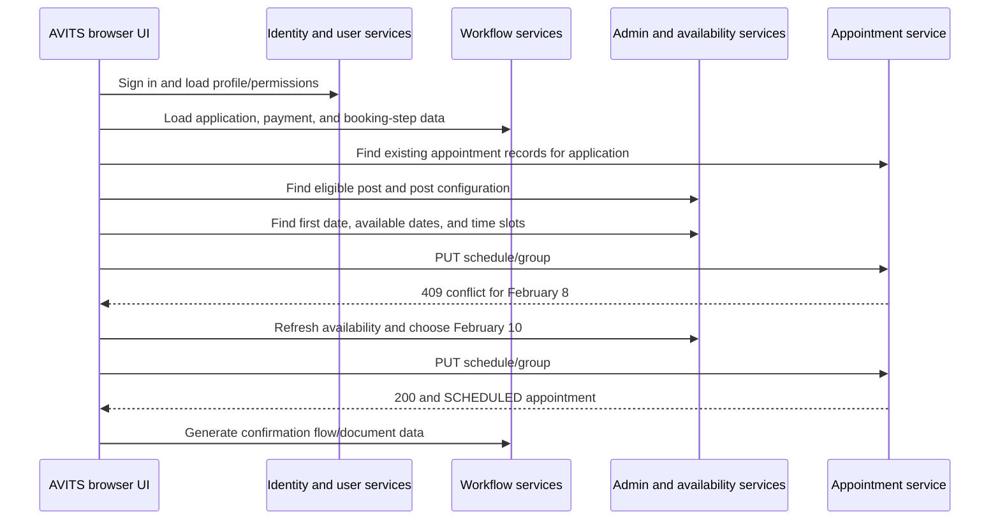

# AVITS Appointment Booking Session: Video API Analysis

Source video: `C:\Users\Masood\Downloads\Video\Video Compressor _ Reduce Video File Size Online.mp4`  
Recording length: about 7 minutes 59 seconds.

## Outcome shown in the recording

The recording shows an AVITS appointment-booking session from sign-in to a confirmation letter. It first attempts to book **8 February 2027 at 7:30 AM**, receives **HTTP 409 Conflict**, refreshes availability, then successfully schedules **10 February 2027 at 7:30 AM in Accra**.

The successful request returns HTTP `200` and an appointment record whose `appointmentStatus` is `SCHEDULED`. The UI then opens a confirmation-letter dialog with a Download button.

Sensitive credentials, bearer tokens, and applicant personal details have been omitted from this document.

## How the pieces fit together



Important distinctions:

- **Preview** and **Response** in DevTools are two views of the same HTTP response; they are not separate calls.
- A green date or returned time slot is only availability information. It does not reserve the slot.
- The final response, not the outgoing request body, proves whether the appointment was scheduled.
- `locationType: "POST"` describes the appointment location type. It is unrelated to an HTTP `POST` method.

## Identifiers carried through the workflow

| Identifier | Recorded value | Meaning |
|---|---:|---|
| `applicationId` | `61a2-c078-e6dc-7a04` | Application/group context |
| `applicantId` | `MLBWURWAIGVP` | Applicant record |
| `missionId` | `315` | Ghana mission |
| `postUserId` | `483` | Accra post |
| `appointmentId` | `2618042` | Existing appointment record that is scheduled |
| `appointmentUUID` | `48bf71d2-2f51-4c80-bf84-529151d5bc7d` | UUID on the scheduled appointment record |
| Workflow ID | `73f86215-5055-49a6-8d25-88f8dc0ca994` | Booking-workflow context |

These are different values with different roles. Do not substitute one for another.

## API endpoint inventory

The base URL for AVITS calls is `https://www.usvisaappt.com`.

| Method | Endpoint | Purpose or visible result |
|---|---|---|
| POST | `/identity/user/login` | `200`; authenticates the applicant |
| GET | `/visauserapi/portal/getuser` | `200`; user profile |
| GET | `/visauserapi/componentAccess/user` | `200`; applicant role and UI permissions |
| GET | `/visaadministrationapi/v1/masterlanguages` | `200`; language catalogue |
| GET | `/visanotificationapi/internalNotification/getAllByUnReadStatus` | `200`; unread count is `0` |
| GET | `/visaappointmentapi/appointments/count/dashboard` | `200`; dashboard counters |
| GET | `/visaworkflowprocessor/workflow/getUserHistoryApplicantPaymentStatus` | `200`; pending application context |
| GET | `/visaappointmentapi/appointments/getLandingPageDetails` | `200`; applicant/application details |
| GET | `/visaadministrationapi/v1/mastercontent/contentsearch/page` | `200`; translated UI text |
| GET | `/visaworkflowprocessor/stepdata/getApplicationMetaData/{applicationId}` | `200`; application, payment, visa, and delivery metadata |
| GET | `/visaworkflowprocessor/workflow/getApplicationHistory/{applicationId}` | `200`; obtains workflow ID |
| POST | `/visaworkflowprocessor/workflow/requestWorkflow/{workflowId}` | `200`; starts/returns workflow state |
| GET | `/visaworkflowprocessor/workflow/getStepData/{workflowId}` | `200`; booking-step configuration |
| GET | `/visaworkflowprocessor/workflow/getMetaData/{applicationId}` | `200`; payment/applicant metadata |
| POST | `/visaappointmentapi/appointments/search` | `200`; finds existing appointment rows |
| GET | `/visaadministrationapi/v1/lookupcdt/wizard/getpost` | `200`; resolves eligible appointment post |
| GET | `/visaworkflowprocessor/workflow/getTransformData/{applicationId}` | `200`; transformed application data |
| GET | `/visaadministrationapi/v1/postconfiguration/get/483` | `200`; Accra-post settings |
| POST | `/visaadministrationapi/v1/modifyslot/getFirstAvailableMonth` | `200`; returns earliest available date |
| POST | `/visaadministrationapi/v1/modifyslot/getSlotDates` | `200`; returns available dates |
| POST | `/visaadministrationapi/v1/modifyslot/getSlotTime` | `200`; returns times and slot IDs |
| PUT | `/visaappointmentapi/appointments/schedule/group` | Final scheduling mutation; first `409`, later `200` |

The recording also shows `https://www.xvisa.io/config.json` and `POST https://xvisa.io/api`. Those calls appear to establish a separate communications/widget session. The video does not show them participating in appointment allocation.

## Authentication and session

### `POST /identity/user/login`

Visible payload shape:

```json
{
  "authorization": "Basic <redacted>",
  "captchaToken": ""
}
```

The subsequent authenticated AVITS calls use:

```http
Authorization: Bearer <redacted>
```

The login JSON response includes user/session information such as `userName`, `userID`, `uuid`, `isActive: "ACTIVE"`, `mfa: false`, `firstTimeLogin: false`, and notification preferences. The body’s `accessToken` is displayed as `null`, but an authorization value is present in the response headers and later requests are authenticated successfully.

The empty `captchaToken` describes this particular recording only; it does not prove CAPTCHA is never required.

## Application and payment context

### `GET /visaworkflowprocessor/workflow/getUserHistoryApplicantPaymentStatus`

Visible response:

```json
{
  "applicationId": "61a2-c078-e6dc-7a04",
  "missionId": 315,
  "messagetext": null,
  "pendingAppoStatus": 1,
  "primaryApplicant": "<redacted>",
  "cancellable": true
}
```

This gives the UI a pending appointment application to continue. The video does not document the exact enum meaning of `pendingAppoStatus: 1`.

### Application metadata

The metadata calls visibly establish these booking inputs:

| Field | Value |
|---|---|
| Visa category | `VisitorVisas` / Visitor Visa |
| Visa class | `B1/B2` |
| Visa type | `NIV` / Non-immigrant Visa |
| Priority | `regular` |
| State | `GreaterAccraRegion` |
| Payment status | `VERIFIED` |
| Payment option | `BANKDEPOSIT` |
| Applicant count | `1` |
| Selected OFC | `35`, OIS Accra |
| Delivery type | `FreeDelivery` / `documentdelivery` |

The `getMetaData` response also shows `feeAmount: 185.0`, `feeUsdAmount: 185.0`, one applicant, and `paymentDetails.paymentStatus: "VERIFIED"`.

No payment action occurs in this recording; the flow starts with payment already verified.

## Existing appointment record

### `POST /visaappointmentapi/appointments/search`

Payload:

```json
{
  "operation": "AND",
  "searchObjects": [
    {
      "fieldType": "STRING",
      "key": "applicationId",
      "operation": "EQUAL",
      "value": "61a2-c078-e6dc-7a04"
    }
  ]
}
```

The response contains appointment IDs `2618041` and `2618042`. Before scheduling, record `2618042` includes:

```json
{
  "appointmentId": 2618042,
  "applicationId": "61a2-c078-e6dc-7a04",
  "applicantId": "MLBWURWAIGVP",
  "appointmentDt": null,
  "appointmentLocationType": "POST",
  "appointmentStatus": "NEW",
  "appointmentTime": null,
  "appointmentType": "REGULAR_NIV",
  "missionId": "315",
  "slotId": null,
  "visaCategory": "VisitorVisas",
  "visaClass": "B1/B2",
  "visaType": "NIV"
}
```

This is why the final call is a `PUT`: it assigns a date and time to an appointment record that already exists. The presence of PUT does not by itself prove a reschedule; the record begins as `NEW` and the UI shows `Not Booked`.

## Post selection: Accra

### `GET /visaadministrationapi/v1/lookupcdt/wizard/getpost`

Query string:

```text
visaCategory=VisitorVisas
visaClass=B1/B2
stateCode=GreaterAccraRegion
priority=regular
missionId=315
```

Important response fields:

```json
{
  "postUserId": 483,
  "missionId": 315,
  "city": "Accra",
  "code": "ACC",
  "countryCode": "GHA",
  "ofcName": "Accra",
  "officeType": "POST",
  "stateCode": "GreaterAccraRegion",
  "status": "A"
}
```

### `GET /visaadministrationapi/v1/postconfiguration/get/483`

Visible settings include:

```json
[
  {
    "postCode": "IS_BIOMETRIC_CAPTURE_SUPPORTED",
    "postValue": "yes"
  },
  {
    "postCode": "postClosingTime",
    "postLabel": "Closing Days",
    "postValue": "2"
  },
  {
    "postCode": "postEndTime",
    "postLabel": "Post End Time",
    "postValue": "17:00"
  }
]
```

The remaining post-configuration entries are present but not expanded in the recording.

## Availability lookup

### First available date

`POST /visaadministrationapi/v1/modifyslot/getFirstAvailableMonth`

Payload:

```json
{
  "applicantId": "MLBWURWAIGVP",
  "applicationId": "61a2-c078-e6dc-7a04",
  "locationType": "POST",
  "postUserId": 483,
  "visaClass": "B1/B2",
  "visaType": "NIV"
}
```

Initial response:

```json
{
  "date": "2027-02-08T00:00:00.000+00:00",
  "message": "Slot is available",
  "present": true
}
```

After the failed booking, a repeat lookup returns `2027-02-10T00:00:00.000+00:00` instead.

Despite the endpoint name, it returns a specific date, which the UI uses to navigate the calendar.

### Available dates

`POST /visaadministrationapi/v1/modifyslot/getSlotDates`

Payload:

```json
{
  "applicantId": "MLBWURWAIGVP",
  "applicationId": "61a2-c078-e6dc-7a04",
  "fromDate": "2027-02-08",
  "locationType": "POST",
  "postUserId": 483,
  "toDate": "2027-02-28",
  "visaClass": "B1/B2",
  "visaType": "NIV"
}
```

Response:

```json
[
  "2027-02-08T00:00:00.000+00:00",
  "2027-02-10T00:00:00.000+00:00",
  "2027-02-16T00:00:00.000+00:00",
  "2027-02-17T00:00:00.000+00:00",
  "2027-02-22T00:00:00.000+00:00",
  "2027-02-23T00:00:00.000+00:00",
  "2027-02-24T00:00:00.000+00:00"
]
```

These become the calendar’s available dates. They are not yet booked slots.

### Time and slot ID

`POST /visaadministrationapi/v1/modifyslot/getSlotTime`

Visible payload for February 8:

```json
{
  "applicantId": "MLBWURWAIGVP",
  "applicationId": "61a2-c078-e6dc-7a04",
  "fromDate": "2026-09-09",
  "postUserId": 483,
  "slotDate": "2027-02-08",
  "toDate": "2026-09-30",
  "visaClass": "B1/B2",
  "visaType": "NIV"
}
```

The September `fromDate`/`toDate` values visibly appear alongside the February `slotDate`. This report retains that inconsistency exactly as shown; the recording does not reveal how the server interprets it.

The response has a selectable 7:30 AM entry:

```json
{
  "date": "2027-02-08T00:00:00.000+00:00",
  "startTime": "2027-02-08T07:30:00.000+00:00",
  "endTime": "2027-02-08T07:45:00.000+00:00",
  "slotId": "9deRLOPP7yZAr5T9HsDnZAXc5RBdnr",
  "slotStatus": "UNBOOKED",
  "status": "A",
  "ruleId": 2443,
  "slotCount": 0,
  "slotDuration": 0
}
```

`slotCount: 0` cannot safely be interpreted as zero availability because the same record is marked `UNBOOKED` and shown as selectable. The video does not define the field.

## Final booking mutation

### Failed request: February 8

`PUT /visaappointmentapi/appointments/schedule/group`

Payload:

```json
[
  {
    "applicantId": "MLBWURWAIGVP",
    "applicantUUID": null,
    "applicationId": "61a2-c078-e6dc-7a04",
    "appointmentDt": "2027-02-08T00:00:00.000+00:00",
    "appointmentId": 2618042,
    "appointmentLocationType": "POST",
    "appointmentStatus": "SCHEDULED",
    "appointmentTime": "7:30 AM",
    "postUserId": 483,
    "slotId": "9deRLOPP7yZAr5T9HsDnZAXc5RBdnr"
  }
]
```

Response: **HTTP `409 Conflict`**

```json
{
  "status": 409,
  "httpStatus": "CONFLICT",
  "requestURL": "/visaappointmentapi/appointments/schedule/group",
  "responseMessage": "Appointment booking failed for :[<applicant>]"
}
```

The recording does not state the cause of the conflict. Slot contention is plausible but unproven. This was a conflict error, not a `401` authentication error.

### Successful request: February 10

The user refreshes availability, selects February 10 and 7:30 AM, then calls the same endpoint again.

```json
[
  {
    "applicantId": "MLBWURWAIGVP",
    "applicantUUID": null,
    "applicationId": "61a2-c078-e6dc-7a04",
    "appointmentDt": "2027-02-10T00:00:00.000+00:00",
    "appointmentId": 2618042,
    "appointmentLocationType": "POST",
    "appointmentStatus": "SCHEDULED",
    "appointmentTime": "7:30 AM",
    "postUserId": 483,
    "slotId": "PU5nmKJ6bRXNlCry2nrfKLD9NXTX6E"
  }
]
```

Response: **HTTP `200 OK`**

Important server-confirmed fields:

```json
{
  "appointmentId": 2618042,
  "applicationId": "61a2-c078-e6dc-7a04",
  "applicantId": "MLBWURWAIGVP",
  "appointmentDt": "2027-02-10T00:00:00.000+00:00",
  "appointmentLocationType": "POST",
  "appointmentStatus": "SCHEDULED",
  "appointmentTime": "7:30 AM",
  "appointmentType": "REGULAR_NIV",
  "appointmentUUID": "48bf71d2-2f51-4c80-bf84-529151d5bc7d",
  "missionId": "315",
  "postUserId": 483,
  "transactionId": "176563712451",
  "visaCategory": "VisitorVisas",
  "visaClass": "B1/B2",
  "visaType": "NIV"
}
```

The response’s `slotId` is different from the `slotId` submitted in the successful payload. The recording does not explain this server-side substitution/allocation, so it should not be assumed to be an error or a known rule.

## Confirmation stage

After the HTTP `200`, the UI shows a toast indicating that POST appointment booking is complete. It opens a **Confirmation Letter** page and dialog stating:

> Your slot is scheduled. Please click the Download button to get your confirmation letter.

The visible letter is titled as a nonimmigrant visa appointment confirmation and includes Accra, one applicant, a group URN, and a barcode.

The recording shows the Download option but does not show a completed download or inspection of the downloaded document.

The network list later includes a row named `generatewizardtemplate` and a `blob:` URL. Their full URL, request method, payload, and response are not expanded, so this recording does not support a complete endpoint contract for them. A `blob:` URL is browser-local output, not an API endpoint.

## Supporting endpoints and visible data

### Role, permissions, UI content

The account is shown with role `Applicant User Role`. Visible permission sections are `My Dashboard`, `Support`, `My Account`, `My Application`, and `Notifications`.

Language records include English (`ENG`), French (`Fr`), and Dutch (`NL`). The master-content calls return UI text such as `My Dashboard`, `PENDING APPOINTMENT REQUEST`, `CANCEL APPOINTMENT REQUEST`, `My Appointments`, and `Select Language`.

### External Xvisa widget

`GET https://www.xvisa.io/config.json` returns widget configuration containing `wss://xvisa.io/api`, `https://xvisa.io/rtc-widgets`, `mode: "production"`, timeouts, and logger settings.

`POST https://xvisa.io/api` returns a response shaped like:

```json
{
  "version": "1.0.0",
  "type": "complete",
  "agent": "Vertex CL",
  "data": {
    "accessExpire": 60,
    "accessToken": "<redacted>",
    "domain": "usvisaappt.com",
    "refreshExpire": 720,
    "refreshToken": "<redacted>",
    "type": "account"
  }
}
```

This looks like separate widget/session activity. The video does not establish a role for Xvisa in AVITS booking.

## Evidence limits and practical conclusions

- The recording proves a booking flow for the captured account at the time it was made. It does not prove an appointment’s present-day status.
- It proves a `409` followed by a fresh availability lookup and a successful `200` booking. It does not expose the backend reason for the `409`.
- It proves the exact fields shown in DevTools. Calls whose body was not opened are listed without invented payloads or contracts.
- The server response is the success evidence: same appointment record, February 10, 7:30 AM, `SCHEDULED`, followed by confirmation UI.
- The recording contains previously exposed secrets and personal data. Redact it before sharing, and rotate any password still in use.

